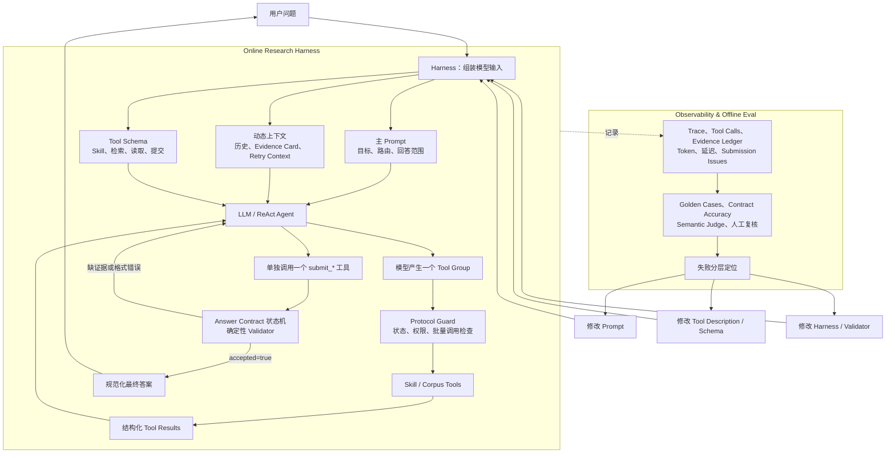

# 梳理一下，prompt的设计和调优和harness

可以把两者的关系概括成一句话：

> **Prompt 是 Agent 的语义策略，Harness 是把这套策略装配、执行、约束、观测和评测起来的运行框架。没有 Harness，Prompt 只是一段文字；有了 Harness，Prompt 才变成可执行、可校验、可调优的行为协议。**

**整体关系图**



## 一、Harness 如何承载 Prompt

Harness 做的第一件事，是把静态 Prompt 和本轮动态信息组装成真正的模型输入。

模型看到的不是单独一段 System Prompt，而是：

```text
主 Prompt
+ 当前可用的 Research Skill 目录
+ Tool Schema
+ 有界会话历史
+ 上一轮实际引用过的 Evidence Card
+ Retry Context
+ 当前用户问题
```

Agent 装配入口在 [runtime.py](/Users/charles/Documents/research/paperloom/harness_py/orchestration/agents/runtime.py:183)，动态上下文注入在 [runtime.py](/Users/charles/Documents/research/paperloom/harness_py/orchestration/agents/runtime.py:195)。

其中主 Prompt 负责：

- `DIRECT/CATALOG/RESEARCH` 的语义边界；
- 回答范围和深度；
- 什么时候澄清；
- 什么内容必须读取论文；
- 什么情况下停止研究；
- 被 Validator 拒绝后应该如何修正。

源码在 [research_contract.py](/Users/charles/Documents/research/paperloom/harness_py/orchestration/research_contract.py:565)。

复杂研究方法不全部放在主 Prompt 中。Harness 只把 Skill 目录常驻上下文，具体方法通过 `get_research_skill` 按需加载，代码在 [research_skills.py](/Users/charles/Documents/research/paperloom/harness_py/orchestration/research_skills.py:20)。

所以在输入层，两者的分工是：

> **Prompt 决定模型应该如何思考当前任务，Harness 决定模型这一轮实际能看到哪些 Prompt、上下文和工具。**

## 二、Harness 如何执行 Prompt

Prompt 告诉模型可以搜索、阅读和提交，Harness 则负责真正运行这个 ReAct Loop。

一次模型调用可以产生多个工具调用，例如同时查找两篇论文：

```text
find_papers_by_identity(A)
find_papers_by_identity(B)
```

Harness 把同一次模型响应里的调用登记为一个 Tool Group，逻辑在 [runtime.py](/Users/charles/Documents/research/paperloom/harness_py/orchestration/agents/runtime.py:72) 和 [context.py](/Users/charles/Documents/research/paperloom/harness_py/orchestration/agents/context.py:175)。

模型可以批量规划，但工具实际串行执行：

```python
parallel_tool_calls=True
max_function_tool_concurrency=1
```

配置在 [runtime.py](/Users/charles/Documents/research/paperloom/harness_py/orchestration/agents/runtime.py:175) 和 [runtime.py](/Users/charles/Documents/research/paperloom/harness_py/orchestration/agents/runtime.py:226)。

每个工具都经过统一流程：

```text
解析参数
→ Protocol Guard
→ 检查当前授权状态
→ 执行业务工具
→ 更新 paper/location/source_quote 状态
→ 记录 Trace
→ 返回结构化 Tool Result
→ 进入下一轮模型调用
```

统一入口在 [tools.py](/Users/charles/Documents/research/paperloom/harness_py/orchestration/agents/tools.py:119)。

因此 Harness 不替模型写死研究路径，但会把模型提出的路径变成有状态、可取消、可记录的实际执行过程。

## 三、Harness 如何约束 Prompt

Prompt 只能提高模型遵守规则的概率，Harness 负责强制执行不可妥协的规则。

### 1. 权限不能只写在 Prompt 中

论文必须先被发现，才能进入本轮 `authorized_paper_ids`；位置必须先被搜索结果披露，才能执行精确读取；读取以后才会登记合法的 `source_quote_ref`。

授权链在 [corpus/tools.py](/Users/charles/Documents/research/paperloom/harness_py/corpus/tools.py:239)。

### 2. 最终提交不能只是普通文本

最终输出必须调用三个提交工具之一：

```text
submit_direct_answer
submit_catalog_answer
submit_research_answer
```

三个 Schema 在 [research_contract.py](/Users/charles/Documents/research/paperloom/harness_py/orchestration/research_contract.py:651)。

普通文本即使内容看起来正确，也不会直接发布。只有提交工具返回 `accepted=true` 并携带结构化 Draft，才会结束 Run，判断在 [tools.py](/Users/charles/Documents/research/paperloom/harness_py/orchestration/agents/tools.py:99)。

### 3. Research 不能在失败后降级成 Direct

第一次合法提交会冻结 Answer Contract。

如果 `submit_research_answer` 因缺引用被拒绝：

```text
ACTIVE, contract=None
→ submit_research_answer
→ UNCITED_CONTENT_BLOCK
→ ACTIVE, contract=RESEARCH
```

模型可以继续补证据，但不能改走 `submit_direct_answer`。状态转换在 [research_contract.py](/Users/charles/Documents/research/paperloom/harness_py/orchestration/research_contract.py:216)。

### 4. Validator 校验 Prompt 无法保证的内容

Research Validator 会检查：

- 是否引用未知的 `source_quote_ref`；
- 是否手写数字引用；
- 是否泄露 `<think>`；
- 每个事实段落、列表项和表格行是否绑定证据；
- 本轮是否真的读取过可引用原文。

实现位于 [research_contract.py](/Users/charles/Documents/research/paperloom/harness_py/orchestration/research_contract.py:435)。

所以在约束层，两者的分工是：

> **Prompt 负责“劝模型遵守”，Harness 负责“模型不遵守时拒绝发布”。**

## 四、Harness 如何驱动 Prompt 调优

Prompt 调优不是孤立修改文案，而是 Harness 提供数据以后进行的失败归因。

一次完整 Run 会留下：

```text
模型每轮输入和输出
Tool Group
工具参数和结果
授权论文、位置和 Source Quote
每次最终提交
Validator Issue
模型调用数
Prompt / Completion Token
模型和 Harness 延迟
最终引用关系
```

模型调用观测在 [runtime.py](/Users/charles/Documents/research/paperloom/harness_py/orchestration/agents/runtime.py:55)，协议状态变化和前后状态快照记录在 [context.py](/Users/charles/Documents/research/paperloom/harness_py/orchestration/agents/context.py:207)。

有了这些数据，调优时先判断失败属于哪一层：

| 失败现象 | 应修改的位置 |
|---|---|
| 技术定义回答过长 | 主 Prompt 的回答范围和停止条件 |
| 推荐理由误走 Catalog | Prompt 与提交工具 Description |
| 模型伪造引用 | Harness 授权链与 Validator |
| `tool_choice=required` 仍返回纯文本 | Provider Adapter 与有界修复 |
| 多次失败 Draft 导致上下文膨胀 | Harness Input Filter |
| 引用存在但不蕴含结论 | 离线 Semantic Judge 和人工审核 |
| 未授权论文读取 | Corpus Tool Guard，不是 Prompt |
| 最终提交和继续搜索出现在同一批 | Protocol Guard |

这就是两者最重要的关系：

> **Prompt 调优负责改善模型行为，Harness 调优负责改善执行可靠性。一次线上问题可能同时需要两者，但必须先定位根因，不能把所有故障都塞回 Prompt。**

## 五、一个完整案例

线上问题“什么事非对称量化”的基线回答：

```text
12 次模型调用
4 次最终提交
172262 Token
3492 个可见字符
```

答案虽然通过引用 Validator，却混入 LLM.int8、Transformer 异常值和 QLoRA NF4。

Harness Trace 表明问题不是检索失败，也不是引用伪造，而是：

```text
Prompt 没有把“证据范围”和“回答范围”分开
+
Validator 拒绝缺引用段落后
模型通过不断扩写和补引用来优化验收信号
```

于是 Git 历史出现了三轮调优：

1. `73be742`：让回答深度服从用户问题；
2. `513f703`：定义题使用渐进式披露，引用修复不能增加主题；
3. `eea17ed`：明确“答案可以短，但 Research Contract 不能降级”。

最终单次生产回放变为：

```text
6 次模型调用
1 次提交
43478 Token
778 个可见字符
```

完整记录在 [research-answer-scope-regression-2026-08-21.md](/Users/charles/Documents/research/paperloom/docs/engineering-evolution/agent-runtime/research-answer-scope-regression-2026-08-21.md:20)。

这里 Prompt 决定“应该答多深”，Harness 则保证：

- 短答案仍然必须读取原文；
- 无引用答案不能发布；
- Research 失败后不能改走 Direct；
- 每次修改都有 Trace、Token 和提交次数可比较。

需要限定的是，这只是一次生产回放，只能证明机制按预期工作，不能宣称稳定节省了约75%的 Token。

## 总结

Prompt 和 Harness 不是两个独立模块，而是一个闭环：

```text
Prompt 定义期望行为
→ Harness 装配并执行
→ Protocol 和 Validator 约束行为
→ Trace 记录实际行为
→ Eval 判断失败属于哪一层
→ 修改 Prompt、Tool 或 Harness
→ 重新回放验证
```

面试中可以这样收束：

> 我把 Prompt 看成 Agent 的语义策略层，把 Harness 看成它的执行与治理层。Prompt 决定如何理解问题、选择研究路径和控制回答范围；Harness 负责上下文装配、工具循环、权限状态、Answer Contract、确定性校验和运行观测。Prompt 调优不是脱离系统改文案，而是根据 Harness 保存的失败轨迹做分层归因，再决定修改 Prompt、Tool Schema 还是 Runtime。这样 Prompt 才是可执行、可回归的工程资产，而不是不可验证的经验文本。